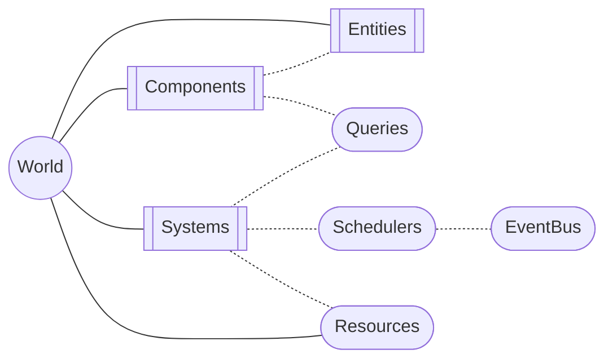
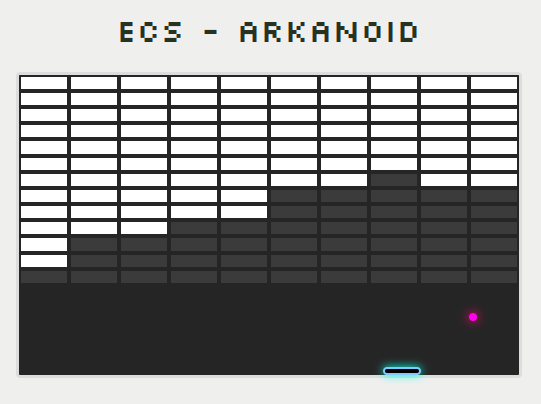
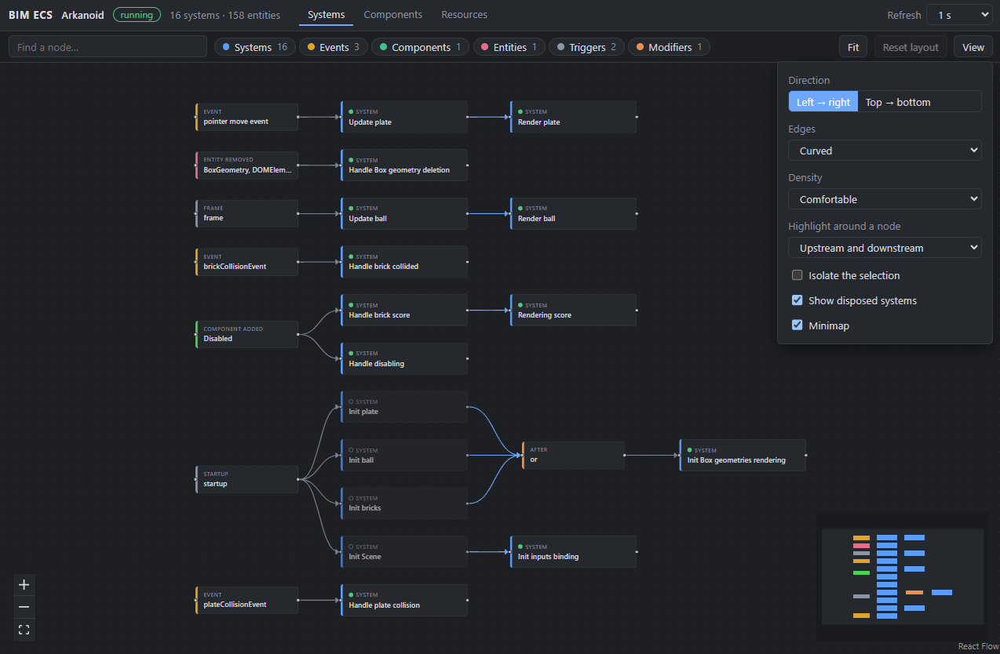

# ECS

(From Wikipedia) Entity–component–system (ECS) is a software architectural pattern mostly used in video game development for the representation of game world objects. An ECS comprises entities composed from components of data, with systems which operate on the components.

## Quick start
`npm i @state-of-geneva/bim-ecs@latest`

```typescript
import { defineSystem, EcsComponent, EcsEvent, EcsWorld, startup } from '@state-of-geneva/bim-ecs';

// Components
class NameComponent extends EcsComponent<string> {}
class AgeComponent extends EcsComponent<number> {}
class HumanComponent extends EcsComponent {}
class AnimalComponent extends EcsComponent {}

// Events
const CLICKED_EVENT = Symbol('CLICKED_EVENT') as EcsEvent<PointerEvent>

// Systems
const initDataSystem = defineSystem('init data', ({ entities }) => {
  entities.spawn(new HumanComponent(), new NameComponent('Fred'), new AgeComponent(35))
  entities.spawn(new HumanComponent(), new NameComponent('Janett'), new AgeComponent(26))
  entities.spawn(new AnimalComponent(), new NameComponent('Teddy'), new AgeComponent(3))
}, startup)

const initInteractionsSystem = defineSystem('init interactions', ({ bus }) => {
  document.addEventListener('click', (e) => bus.publish(CLICKED_EVENT, e))
}, startup)

const listHumansSystem = defineSystem('list humans', ({ entities }) => {
  const humanEntities = entities.query(() => [HumanComponent])
  for (const entity of humanEntities) {
    console.log('Humans', Array.from(entities.componentsOf(entity).values()))
  }
}, on(CLICKED_EVENT))

/** World instance */
const world = new EcsWorld()
  .registerSystem(initDataSystem)
  .registerSystem(initInteractionsSystem)
  .registerSystem(listHumansSystem)
  .run()
```

## What this ECS implementation is designed for :

- Modularisation
- Entities querying on a large amount of data (byteECS is doing a very nice job on this but doesn't have required feature + component values cannot be strings)
- Components value indexing (WIP)
- Advanced systems scheduling

## What this ECS implementation is NOT designed for :

The architecture of this project has been built as a requirement for the BIM project at "Etat de Genève". This means some features are required, others are nice to have, and some
are unwanted, because readability may be more important than performances in some cases and vice versa.

**Example :**
Systems parallelization

> Generally speaking, systems runtime is not critical for the project this ECS implementation has been written for. However, some
> optimizations in the implementation are highly possible seamlessly without being counter-productive toward the original purposes.

## Structure overview

BIM-ECS implements a world, hosting Entities, Components and systems.  
Entities are fetched from world using queries.  
Additional features such as `Resources`, `Scheduler`, `EventBus` adds convenient mechanisms to interact with the world and your application.



**Show me the code :**

> `//TODO: show entities/components`

```typescript
import { EcsWorld } from './world';
import { defineSystem } from './systems/define-system';
import { startup, timer } from './scheduling';
import { after } from './scheduling/after';
import type { EcsEvent } from './event-bus';
import { on } from './scheduling/on';
import { EcsResource } from './resources';

/** world instance */
const world = new EcsWorld({ verbose: true });

/** Counter state resource */
class CounterResource extends EcsResource {
  constructor(public value = 0) {
    super();
  }
}

// Event handling
const clickEvent = Symbol('clickEvent') as EcsEvent<{ boost: 20 }>;
document.addEventListener('click', () => world.bus.publish(clickEvent, { boost: 20 }));

// Systems
const initSystem = defineSystem(
  'init',
  ({ container }) => {
    console.log('Hello init');
    container.register(new CounterResource(5));
  },
  startup, // At startup
);

const initSystem2 = defineSystem(
  'init 2',
  () => {
    console.log('Hello init 2');
  },
  after(initSystem), // After init system has finished (supports async predecessor)
);

const pollSystem = defineSystem(
  'polling',
  ({ container }) => {
    console.log('I am polling, counter value is: ', container.resolve(CounterResource).value++);
  },
  timer(1000), // Each second
);

const handleClickSystem = defineSystem(
  'handle click',
  ({ container }, { payload }) => {
    console.log('boost counter', payload, (container.resolve(CounterResource).value += payload.boost));
  },
  on(clickEvent), // On browser page click
);

// Registration
world
  .registerSystem(initSystem)
  .registerSystem(pollSystem)
  .registerSystem(initSystem2)
  .registerSystem(handleClickSystem);

// World activation
world.run();
```

## Démo projects

A démo project is part of this monorepo (many others to come hopefully :-).  
Checkout the ["ECS- Arkanoid" source code](./demo/arkanoid/src) to see ECS library in action:



Systems structure (cf. tooling) :  


**Run the project on local machine :**  
From the root folder,

- `pnpm install`
- `pnpm start:demo-arkanoid`

This builds the demo's workspace dependencies (`@state-of-geneva/bim-ecs` and the devtools plugin), then starts the Vite dev server (default: `http://localhost:5173`).  
Once the libraries are built, you can skip the build step and only start the dev server with `pnpm --filter @bim-ecs/ecs-arkanoid start`.

## Tooling

A (for now) very pragmatic Chromium extension has been created within this project to help debugging ECS projets.
For now, it only represents the systems structure of the ECS world as a graph:


## World

ECS root instance.  
Every instance within an `EcsWorld` has its life cycle tied to it.  
The whole API is also available from this root.

## Entities

Entities are actually indexes from which components are linked. `EntityPool` world instance is used to handle life cycle

### Creating a new entity

This creates 2 entities within the world

```typescript
import { EcsWorld } from './ecs-world';
import { EcsComponent } from './component';

class Person extends EcsComponent {}
class Animal extends EcsComponent {}
class NameComponent extends EcsComponent<string> {}

const world = new EcsWorld();
world.entities.spawn(new Person(), new NameComponent('Bob'));
world.entities.spawn(new Animal(), new NameComponent('Foxy'));
```

### Removing an entity

This creates 2 entities within the world and removes foxy

```typescript
import { EcsWorld } from './ecs-world';
import { EcsComponent } from './component';

class Person extends EcsComponent {}
class Animal extends EcsComponent {}
class NameComponent extends EcsComponent<string> {}

const world = new EcsWorld();
world.entities.spawn(new Person(), new NameComponent('Bob'));
const foxyEntity = world.entities.spawn(new Animal(), new NameComponent('Foxy'));

// Microtask delay here

world.entities.remove(foxyEntity);
```

### Fetching entity components

```typescript
import { EcsWorld } from './ecs-world';
import { EcsComponent } from './component';

class Person extends EcsComponent {}
class Name extends EcsComponent<string> {}

const world = new EcsWorld();
const person = world.entities.spawn(new Person(), new Name('Bob'));

const components = world.entities.componentsOf(person);
const personNameValue = components.get(Name)!.value;
```

### Updating entity composition

This transforms foxy into a person

```typescript
import { EcsWorld } from './ecs-world';
import { EcsComponent } from './component';

class Person extends EcsComponent {}
class Animal extends EcsComponent {}
class Name extends EcsComponent<string> {}

const world = new EcsWorld();
world.entities.spawn(new Person(), new Name('Bob'));
const foxyEntity = world.entities.spawn(new Animal(), new Name('Foxy'));

// Microtask delay here

world.entities.removeComponent(foxyEntity, Animal);
world.entities.addComponent(foxyEntity, new Person() /* Instance could also have been eventually reused*/);
```

- `addComponent(entity, ...components)` returns `true` when at least one component has been added (adding the very same instance twice is ignored).
- `removeComponent(entity, ...types)` removes every component of the given types and returns `true` when at least one component has been removed.

### Updating the composition of multiple entities at once

`addComponents` and `removeComponents` mutate every entity matching a query in a single call. They accept any
[query definition](#querying), `without` and `anyOf` statements included.

```typescript
import { EcsWorld, EcsComponent } from '@state-of-geneva/bim-ecs';

class Person extends EcsComponent {}
class Animal extends EcsComponent {}
class Citizen extends EcsComponent {}
class Name extends EcsComponent<string> {}

const world = new EcsWorld();

// Every animal becomes a person (the factory is invoked once per matched entity)
world.entities.addComponents(
  () => [Animal],
  () => new Person(),
);

// The factory can also provide several components: every unnamed person gets a default name and becomes a citizen
world.entities.addComponents(
  ({ without }) => [Person, without(Name)],
  () => [new Name('Anonymous'), new Citizen()],
);

// Every person stops being an animal
const matchedEntities = world.entities.removeComponents(() => [Person], Animal);
```

- The query is evaluated once, before any mutation, and its result is snapshot. Entities moving across archetypes
  because of the mutation are never visited twice, and entities starting to match because of it are not visited.
- Both methods return the identifiers of the entities **matched by the query**, including those on which nothing changed
  (for instance because they did not hold the removed component types).
- Since they run a query, they are not available during an [initialization session](#performances-consideration).

## Components

// TODO finalize implementation

ECS components inherit `EcsComponent<TValue>` class or derived. There are basically 3 kind of base classes provided by the library:

- `EcsComponent<TValue>` (with `TValue = void` by default) stands for an immutable component
- `EcsMutableComponent<TValue>` (with mandatory `TValue`) stands for a component with a mutable value. This mutation can be used to schedule systems handling this mutation for instance (WIP)
- `EcsIndexedComponent<TValue>` (with mandatory `TValue`) stands for a component with an immutable value which can be used in queries (WIP)

> Important current limitation: The current ECS implementation can handle a limited combinations of archetypes.
> Combinations are using bits masking through `UInt32Array`. The size of these arrays are fix for now and may be dynamic in the future.
> Queries performance is directly impacted by the size of this array. For now, default size is pretty bix (about 16 / 32 combinations).  
> A config parameter should at least be exposed in world construction.  
> To be finalized...

## Querying

### Basics of querying

Entities are fetched with `world.entities.query(definition)`. A query definition is a function returning the statements
the entities must satisfy.

```typescript
import { EcsWorld, EcsComponent, EcsIndexedComponent } from '@state-of-geneva/bim-ecs';

// Components
class Person extends EcsComponent {}
class Animal extends EcsComponent {}
class Frozen extends EcsComponent {}
class Name extends EcsIndexedComponent<string> {}

const world = new EcsWorld();

// Entities
world.entities.spawn(new Person(), new Name('Bob'));
world.entities.spawn(new Animal(), new Name('Foxy'));

// Queries
world.entities.query(() => [Person, Name]); // Person and Name
world.entities.query(({ without }) => [Person, without(Frozen)]); // Person and not Frozen
world.entities.query(({ withValue }) => [Animal, withValue(Name, 'Foxy')]); // Animal and Name with value 'Foxy'
world.entities.query(({ anyOf }) => [Name, anyOf(Person, Animal)]); // Name and (Person or Animal)
world.entities.queryOne(() => [Person]); // First match, `undefined` if there is none
```

### Query statements

| Statement                            | The entity matches when...                                       |
| ------------------------------------ | ---------------------------------------------------------------- |
| `Component` or `include(Component)`  | it holds the component                                           |
| `without(Component)`                 | it does **not** hold the component (_not_ operator)              |
| `anyOf(ComponentA, ComponentB, ...)` | it holds **at least one** of the listed components (_or_ operator) |
| `withValue(IndexedComponent, value)` | it holds the indexed component with this value                   |

- Statements are combined with an _and_. Several `anyOf` statements are all required: `[anyOf(A, B), anyOf(C, D)]`
  means `(A or B) and (C or D)`.
- A query made of `without` statements only matches every entity not holding these components.
- `anyOf` requires at least one component type and applies to component types, not to indexed values. An _or_ between
  whole conditions (`A and B`, or `C`) is expressed with two queries.
- `withValue` requires an `EcsIndexedComponent`.

> A query result is a lazy iterable reading live data. Do not add or remove components while iterating it (entities
> moving across archetypes may be visited more than once): spread the result first (`[...world.entities.query(...)]`) or
> use the [batch mutation](#updating-the-composition-of-multiple-entities-at-once) methods, which do it for you.

### Query processing details

Queries and entities are preprocessed and categorized by archetype to maximize execution and reduce redundant operations.

1. **Compilation**: a query definition is compiled once. Its component statements become bitwise masks (to include, to
   exclude, and one per `anyOf` statement) cached on the compiled query, and schedulers filtering on a query compile it
   once instead of on every event.
2. **Archetype pass**: every archetype is tested with bitwise operations only (no allocation). Included components must
   all be part of the archetype (_and_), excluded components must be absent from it (_not_), and each `anyOf` statement
   must share at least one component with it (_or_).
3. **Value pass** (`withValue`): the engine crosses archetypes with the value indexes using the cheapest strategy:
   archetypes only when the query has no `withValue`, indexes only when it has nothing else, otherwise it walks the
   smaller of both entity sets and probes the other. A value no entity holds ends the query right away with no result.

Archetypes and value indexes are updated incrementally when entities mutate: adding or removing a component flips the
bits of its type in the entity archetype (the entity moves to the matching archetype) and updates the single value
index entry concerned. The cost of a mutation only depends on the number of components of the mutated entity, not on the
number of entities, archetypes or indexed values.

An entity may hold several components of the same type: its archetype (and the value index entry of each value) is kept
until the last matching component is removed.

### Filtering schedulers with queries

Schedulers filtering on entities accept the same query definitions, `without` and `anyOf` included:

- `spawned(query)` and `entityRemoved(query)`: entities spawned / removed matching the query
- `componentAdded(Type, query?)` and `componentRemoved(Type, query?)`: a component of this type added to / removed from
  an entity matching the query. The entity is tested in its state right after the mutation.

```typescript
import { defineSystem, componentAdded } from '@state-of-geneva/bim-ecs';

defineSystem(
  'foo',
  (_, { payload }) => {
    // payload.entity is a Soldier (not Disarmed) which just received a Weapon
  },
  componentAdded(Weapon, ({ without }) => [Soldier, without(Disarmed)]),
);
```

## Systems

### Scheduling

Handles systems scheduling.

Scheduling extends [`Scheduler`](./scheduler.ts). It is used by system runner to trigger systems at predefined time.  
At its core, it uses [AsyncIterator](https://developer.mozilla.org/en-US/docs/Web/JavaScript/Reference/Global_Objects/AsyncIterator)
to create "ticks" on which associated systems are triggered.

#### Existing schedulers

##### startup

This is the most basic scheduler, triggering once when the world is started.

```typescript
import { defineSystem } from './define-system';
import { startup } from './startup';

defineSystem(
  'foo',
  () => {
    // implementation here
  },
  startup, // Triggers the system only once at world startup
);
```

##### timer

This scheduler is triggering a Date.Now() each specified interval. Interval is specified as a parameter.

```typescript
import { defineSystem } from './define-system';
import { timer } from './timer';

defineSystem(
  'foo',
  () => {
    // implementation here
  },
  timer(500), // Triggers the system every 500ms
);
```

##### frame

This scheduler triggers each frame

```typescript
import { defineSystem } from './define-system';
import { frame } from './frame';

defineSystem(
  'foo',
  () => {
    // implementation here
  },
  frame, // Triggers the system every frame
);
```

##### on

This scheduler when the specified event is fired within the world event bus

```typescript
import { defineSystem } from './define-system';
import { on } from './on';
import { EcsEvent } from './ecs-event';

const FOO_EVENT = Symbol('foo event') as EcsEvent<number>;

defineSystem(
  'foo',
  (_, { payload }) => {
    // payload is the event args (of type number in this case) the event has been fired with
    // implementation here
  },
  on(FOO_EVENT), // Triggers the system whenever the event is fired from world event bus
);
```

##### after

This scheduler is triggered whenever specified system has finished processing

```typescript
import { defineSystem } from './define-system';
import { after } from './after';

const system1 = defineSystem(/* System parameters here */);
defineSystem(
  'foo',
  () => {
    // implementation here
  },
  after(system1), // Triggers the system each time the system1 has finished being processed
);
```

Multiple systems can be specified. A combination option can be set (default value is `or`)

```typescript
import { defineSystem } from './define-system';
import { after } from './after';

defineSystem(
  'foo',
  () => {
    // implementation here
  },
  after([system1, system2], {
    combination: 'and', // Triggers the system each time the system1 AND system2 have been BOTH processed
  }),
);
```

#### Scheduler modifiers

##### compose

Scheduler can be aggregated this way:

```typescript
import { compose } from './compose';

compose(scheduler1, scheduler2); // Creates a scheduler combining scheduler1 and scheduler2 ticks
```

##### debounce

Scheduler can be debounced this way:

```typescript
import { debounce } from './debounce';

debounce(scheduler1, 10); // Resulting scheduler won't tick until scheduler1 separates its own ticks with at least 10ms
```

##### when

Scheduler can be filtered this way:

```typescript
import { when } from './when';

debounce((world) => {
  // Prepare here (container resolution for instance)
  return () => computePredicate(); // Process filter here
}, scheduler1); // Resulting scheduler won't tick if predicate result is falsy
```

## Resources

Handles world resources definition and injection.  
The ResourceContainer class provides a mechanism for resolving and managing instances of resources.  
It supports both lazy creation of resources and registration of pre-existing resource instances.

### Basic usage

```typescript
import { EcsResource } from './ecs-resource';

const resourceContainer = new ResourceContainer();

class MyResource extends EcsResourceResource {}

const myResourceInstance = resourceContainer.resolve(MyResource); // Creates and returns a new instance of MyResource
const sameResourceInstance = resourceContainer.resolve(MyResource); // Returns the existing instance of MyResource
```

##3 Resources Factory

An `EcsResourceFactory<TResource>` is also provided to handle special cases such has nested dependency injection.  
For instance, let's consider `FooResource`, a class in which I want `BarResource` being injected. I can leverage `EcsResourceFactory`

```typescript
class FooResource {
  constructor(private readonly barResource: BarResource) {}
}
```

## EventBus

Handles pub/sub mechanism within a world instance.

The `EventBus` class provides a simple event management system for subscribing to and publishing events. It supports type-safe
event keys and allows handlers to be subscribed and unsubscribed dynamically.

By using `EcsEvent` symbols and generic types,
it ensures that events are handled in a type-safe manner.  
The `subscribe` method allows handlers to be added and returns a dispose
function for easy un-subscription, while the publish method notifies all subscribed handlers with the event data.

### Basic usage:

```typescript
// Define some event keys
import { EcsEvent } from './ecs-event';

const eventA = Symbol('eventA') as EcsEvent<string>;
const eventB = Symbol('eventB') as EcsEvent<number>;

// Create an event bus instance
const eventBus = new EventBus();

// Subscribe to events
const unsubscribeA = eventBus.subscribe(eventA, (value: string) => {
  console.log('Event A received:', value);
});
const unsubscribeB = eventBus.subscribe(eventB, (value: number) => {
  console.log('Event B received:', value);
});

// Publish events
eventBus.publish(eventA, 'Hello, Event A!');
eventBus.publish(eventB, 42);

// Unsubscribe from events
unsubscribeA();
unsubscribeB();

// Publish events again to see if handlers are removed
eventBus.publish(eventA, 'Hello again, Event A!');
eventBus.publish(eventB, 84);
```

## Plugins

Plugins can be used to package features connected to `EcsWorld`:

```typescript
import { EcsPlugin } from './ecs-plugin';

const FooPlugin: EcsPlugin = (world) => {
  // Systems registration
  world.registerSystem(foo1System);
  world.registerSystem(foo2System);

  // Queries registration
  world.query.register(fooQuery);

  // Resources declaration
  world.container.register(FooResource, new FooResource('foo'));

  // Event handling, ect...
};
```

Registered on to world instance this way:

```typescript
import { EcsWorld } from './ecs-world';
import { FooPlugin } from './foo-plugin';

/** Ecs world instance */
const world = new EcsWorld();

// Plugin registration
world.use(FooPlugin);
```

## Performances consideration
The bim-ecs library is optimized primarily for fast querying. Any read/write/update operation on entity updates some indexes tables to guaranty fast query result as possible, with the cost
of the indexes tables update.

Components addition/removal updates the entity archetype and the value indexes incrementally: its cost only depends on the number of components of the entity, not on the number of entities. It still costs more than spawning an entity with its whole component set, since each addition or removal moves the entity between archetypes and publishes an event: Prefer spawning entities with the whole component set instead of creating an entity and updating it afterward.

To update a lot of entities sharing some criteria, `addComponents` / `removeComponents` evaluate the query once for all of them (cf. [batch mutation](#updating-the-composition-of-multiple-entities-at-once)).

If for some reason this is not possible (example: Some components could contain some reference to spawned entities -> These reference components should probably be added once entities are spawned),
an initialization session can be open to reduce entity mutation overhead:

```typescript
import { EcsWorld } from '@state-of-geneva/bim-ecs';

const world = new EcsWorld()

{
  // Init session scope
  using _ = world.openInitSession()

  const entity = world.entities.spawn(new MyComponent1('foo'))
  // [...]
  world.entities.addComponent(entity, new MyComponent2('bar')) // <- Very fast in this context
  
  // End of init session scope
}

// world is running normally from here
```

This `initSession` scope should only be used for entity initialization. 
- Entity spawning
- Components associations (only for entities added during this scope !)

Some operations are not available during the session and should not be attempted :
- Querying (including batch mutation with `addComponents` / `removeComponents`, which runs a query)
- Entity deletion

## Debugging

The structure of a world (systems, how they are scheduled, components, entities, resources) can be inspected with the BIM ECS DevTools browser extension, through a plugin:

```typescript
import { devtoolsPlugin } from '@state-of-geneva/bim-ecs-devtools-plugin';

world.use(devtoolsPlugin({ name: 'My game' }));
```

Nothing is computed until a tool asks for it, and the library knows nothing about how the data is displayed: the plugin publishes plain JSON on a global hook. See [the plugin](./packages/ecs-devtools-plugin) and [the extension](./packages/ecs-chrome-extension).

## How to contribute

If your project match our needs, you may be interested in some additional features or improvements. As such, contribution is very welcome.  
If this library is currently used for "État de Genève" BIM project, there are still things to maturate, nice features to add, tools to enhance and issues to find.

In any case, feel free to create an issue or a pull request if you have any feedback or suggestion about the current implementation.  
It definitely helps and these will be considered with care !

## NPM publication 

- `npm run sync-packages-versions`
- `npm install`
- build all
- `npm publish --workspaces=true`